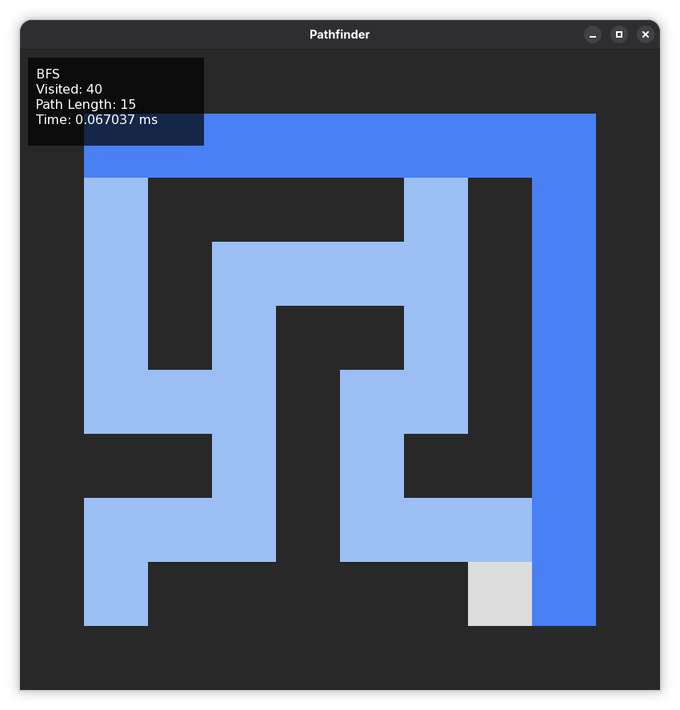
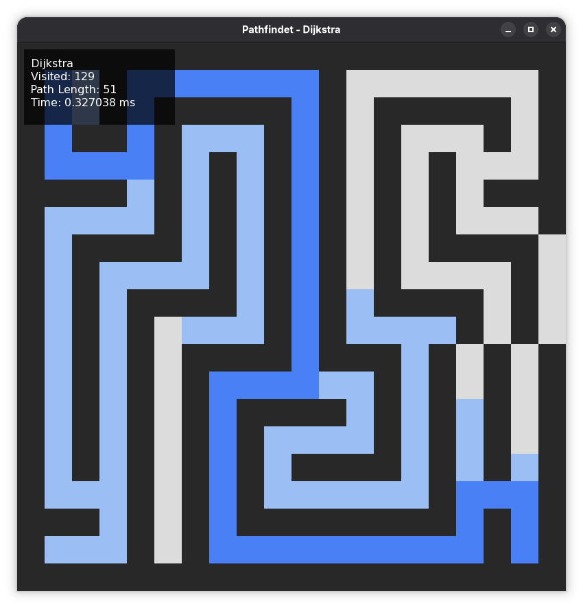

# Pathfinder Visualizer
# Визуализация алгоритмов поиска путей

Визуализатор алгоритмов поиска путей на сетке. Алгоритмы выполняющие поиск:
 - BFS (Breadth‑First Search, Поиск в ширину)
 - DFS (Depth‑First Search, Поиск в глубину)
 - Dijkstra (Dijkstra’s algorithm, Алгоритм Дейкстры)
 - A* (A Star, Поиск по наилучшему совпадению)

## Алгоритм работы

1. Загрузка лабиринта из текстового файла;
2. Поиск пути от "S" до "E" представленными алгоритмами;
3. Визуализация поиска при помощи SFML;
4. Таблица метрик для сравнения по критериям: посещенные клетки, длина пути, время.

## Внешний вид приложения




## Структура

src/
 - core/          — grid, point, SearchResult
 - algorithms/    — BFS, DFS, Dijkstra, AStar
 - main.cpp       — точка входа, визуализация
assets/
 - mazes/         — тестовые лабиринты
 - fonts/         — шрифт для метрик

## Сравнение алгоритмов

Лабиринты: 
 - small - 10x10
 - maze20 - 20x20

| Лабиринт | Алгоритм | Visited | Path length | Time (ms) |
|----------|----------|---------|-------------|-----------|
| small    | BFS      | 40      | 15          | 0.065     |
| small    | DFS      | 38      | 15          | 0.058     |
| small    | Dijkstra | 39      | 15          | 0.152     |
| small    | A*       | 27      | 15          | 0.111     |
| maze20   | BFS      | 131     | 51          | 0.289     |
| maze20   | DFS      | 58      | 51          | 0.071     |
| maze20   | Dijkstra | 129     | 51          | 0.385     |
| maze20   | A*       | 95      | 51          | 0.227     |


## Управление

- "R" - перезапуск анимации
- "1" - BFS
- "2" - DFS
- "3" - Dijkstra
- "4" - A*

## Сборка

Требования:
 - C++17;
 - CMake 3.20+;
 - SFML - 2.5+;

```bash:
cmake -B build -G Ninja
cmake --build build
./build/pathfinder {необязательно: ваш путь до карты}
```
Пример:
```bash
./build/pathfinder assets/mazes/maze20.txt
``` 

